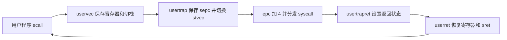

# 实验 2 设计笔记

本阶段完成用户态陷入和返回、系统调用、时钟与 UART 中断，以及最小 Shell 交互。保持 satp=0，不实现页表、完整轮转调度、文件系统或 exec 参数压栈。

## 本学号参数

学号 2024302181049。参数直接引用 kernel/course_sid.h：LAB2_TICK=1、LAB2_BUF_SEMANTICS=1（字符流）、LAB2_BUF_SIZE=64。未修改参数文件。时钟基础周期为 1000000 个 time 计数，下一次比较值为当前 time 加基础周期乘 LAB2_TICK。

## 内存与预置接口适配

用户程序执行区是物理地址 0x81000000 起的 64 KiB，顶部 4 KiB 留给用户栈，栈顶按 16 字节对齐。每个进程在内核静态存储中拥有独立的 64 KiB 镜像备份、trapframe 和 4 KiB 内核栈。仅提供两个进程槽，满足 sh 与一个前台子进程。

没有地址空间隔离。同一时刻只有当前进程的用户镜像位于执行区；让出 CPU 后保存执行区，恢复另一个进程前载入其备份。这样 fork 复制出的父子镜像互不覆盖，无需分页或动态页分配。

预置 trampoline.S、memlayout.h、user.ld、Makefile.upgrade 原文保持不变。构建 trampoline 时从标准输入读取预置汇编，通过 kernel/bare/memlayout.h 将 TRAPFRAME 定义为物理地址 0x87fff000；为生成的对象设置可装载代码段属性。该位置是单核共享的陷入中转区，每次陷入后复制到当前进程自己的 trapframe，返回前重新填入中转区。

用户链接时通过目标专用的 LD 参数将 .text 放到执行区基址，避免按地址 0 链接的绝对符号在 Bare 模式下失效。tools/user_meta.py 从 ELF 提取实际入口和内存大小；不是假定 main 位于镜像第一字节。exec 清零整个执行区后复制二进制，所以 BSS 和用户栈均有确定初值。

## 系统调用往返

用户桩将调用号放在 a7、参数放在 a0 到 a2，然后执行 ecall。

U 态 → 硬件保存 sepc、更新特权状态并跳转 stvec → uservec 将寄存器保存在中转 trapframe、加载当前进程内核栈 → usertrap 切换 stvec 到 kernelvec、复制现场 → ecall 分支将 epc 加 4 → syscall 分发并将结果写入 a0 → usertrapret 配置 SPP=0、SPIE=1、sepc 和当前进程的内核栈信息 → userret 恢复现场 → sret 返回 U 态。

CPU 不自动保存通用寄存器或切换栈。trapframe 的字段次序来自预置汇编的 sd/ld 偏移；其中 kernel_sp 为 8、epc 为 24、a0 为 112、a7 为 168 字节。预置版本使用 sscratch 暂存用户 a0，userret 接收的是 satp 值（本阶段为 0）。

系统调用分发表使用 switch。实现 fork、exit、wait、read、exec、getpid、write；其余编号和未知编号返回 -1。用户指针直接访问物理执行区，并做区间和长度检查，不引入 copyin/copyout 页表机制。

## 最小进程生命周期

fork 复制用户执行区和用户寄存器，子进程返回值为 0，父进程返回子 PID；子进程的内核栈独立，返回前重新填充内核现场字段。wait 没有已退出子进程时睡眠并切换内核栈；exit 标记子进程为 ZOMBIE 并唤醒父进程；父进程收集状态、释放进程槽。

只在 read 和 wait 等等待点让出 CPU。时钟中断处理后直接返回当前进程，不进行时间片轮转。spin 是前台无限循环程序；测试用独立的 QEMU 实例验证它，结束测试时关闭该实例。

## 输入缓冲与同步

UART 接收中断由 PLIC 分发给 consoleintr。生产者排空硬件 FIFO，回显字符，将回车转换为换行，随后把字符写入环形缓冲。r、w 是单调递增计数，下标取模 LAB2_BUF_SIZE；w-r 等于容量时丢弃后续字符。

ready 表示可读取边界。字符流模式下每字符到达后更新 ready 并唤醒；consoleread 在空缓冲时等待，有数据时返回最多请求长度的当前可用数据，不等待换行或请求长度凑满。行缓冲分支只在换行时提交 ready，读取到换行后返回。

单核下利用中断关闭保护缓冲和进程状态。系统调用入口的中断关闭状态覆盖条件检查到登记睡眠、切换内核栈的整个过程，避免丢失唤醒。等待过程中 CPU 回到可开中断的内核空闲循环，UART 仍能写入和唤醒。没有多核锁或完整调度器。

| 缓冲状态或事件 | 操作与转移 |
|---|---|
| 空：r == ready | 读进程登记等待并让出 CPU |
| 字符到达且未满 | 写入 buf[w % 64]，w 增加；字符流模式提交 ready 并唤醒 |
| 满：w - r == 64 | 丢弃新字符，不越界修改缓冲 |
| 有可读数据 | 复制最多请求长度的可用字符，r 增加并返回 |
| 计数跨越数组尾部 | 对 64 取模访问，单调计数不重置 |

## exec 内嵌表

按程序名查找 _uprog_table，名称先在内核缓冲中去掉 gets 保留的末尾换行。预置表生成器把每个程序镜像放在该表项后，因此下一项的位置是当前镜像 end 按 8 字节对齐后的地址。exec(name, argv) 的签名保持不变，本阶段忽略 argv。

## 自检

在工程根目录执行：

    make kernel
    python3 check_expect.py 2024302181049
    python3 support/inject_uart.py --tree . --script storm.txt --log inject_uart.log

storm.txt 按验收参考检查 Banner、sh、hi、badecall、bufstorm 四行的完整回显与 24 字节计数、十次连续命令，以及 spin 期间的 UART 输入和超过 64 字节的压力输入。所有 EXPECT 应通过，末尾“EXPECT 失败”应为 0；还应查看日志中超长输入后 spin 是否继续输出，且没有 trap 报错。

预置驱动自行启动 QEMU，并要求 fs.img；本工程提供 1 MiB 占位镜像，仅供驱动挂载，不实现磁盘或文件系统。驱动等待的提示符是 $ 而当前 Shell 是 sh>，所以 boot TIMEOUT 可能是误报，以日志和 EXPECT 检查为准。

本学号为字符流模式。consoleintr 回显输入，bufstorm 又用 write 回显读到的数据，因此手敲 1 会显示 11，换行也显示两次。bufstorm 的 lines 字段实际累计成功的 read 次数；手敲字符、回车分别可能完成一次 read，因此不能把“四次读取”当成“四行键盘输入”。预置测试与内核字符流语义保持不变；用 storm.txt 一次注入一整行来执行四行验收，并核对 bytes=24 和逐行回显。
